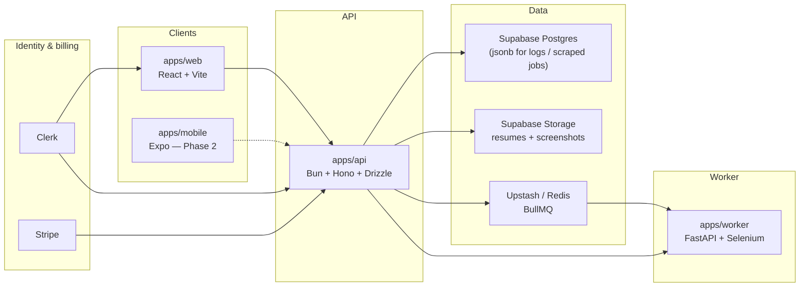

# JobPilot

Job application autopilot and tracker for job seekers who are tired of spreadsheets and re-typing the same profile into every ATS. Track applications on a Kanban board, score resume–JD fit with AI, and auto-fill Greenhouse/Lever-style forms with a **human-in-the-loop** confirmation step — the worker never submits without you.

**Live demo:** [https://jobpilot-a7i.pages.dev](https://jobpilot-a7i.pages.dev)

Deploy notes: [`docs/DEPLOY.md`](./docs/DEPLOY.md) · Local keys: [`docs/KEYS_AND_SETUP.md`](./docs/KEYS_AND_SETUP.md).

---

## Why I built this

Job search tooling is either a spreadsheet or a black-box “auto-apply” bot that violates ATS terms of service. JobPilot is the middle path: a production-shaped SaaS that a recent CS grad can actually use, with automation designed so a human always reviews the filled form before submit. That safety choice is ethical, interview-defensible, and harder to get right than a reckless click-submit scraper.

---

## Architecture



**Auth model:** Clerk is the only identity provider. Supabase is managed Postgres + Storage — no Supabase Auth, no Row Level Security. The Node API verifies Clerk JWTs and filters every query by `user_id`. Authorization lives in one place (middleware + handlers), which is simpler to test than duplicating rules in Postgres policies.

**Automation safety:** The Python worker fills the form, captures a screenshot, and **stops**. Final submit requires an explicit user confirmation. Many ATS terms forbid unattended auto-submission; this design respects that and keeps a human in the loop.

---

## Tech stack

| Layer | Tech |
|---|---|
| Web | React 18 + TypeScript + Vite, TailwindCSS, shadcn/ui |
| Mobile (Phase 2) | Expo + TypeScript, shared types with web/API |
| API | Node.js + Bun + Hono, Drizzle ORM |
| Worker | Python 3.11 + Selenium + FastAPI |
| Database | Supabase Postgres (`jsonb` for semi-structured logs) |
| Files | Supabase Storage |
| Auth | Clerk |
| Payments | Stripe subscriptions |
| Queue | BullMQ + Redis |
| CI | GitHub Actions — lint, typecheck, test on every PR |

---

## Monorepo

Bun workspaces + Turborepo.

```
apps/web          React + Vite frontend
apps/api          Bun API (Hono + Drizzle)
apps/worker       Python FastAPI + Selenium
apps/mobile       Expo app (Phase 2)
packages/shared-types   Types shared by web, mobile, and API
packages/ui             Shared UI primitives (shadcn)
packages/config         Shared TypeScript, ESLint, Prettier configs
```

---

## Local development

**Prerequisites:** [Bun](https://bun.sh) >= 1.2, Docker (for Redis), a free [Supabase](https://supabase.com) project, [Clerk](https://clerk.com) application.

```bash
# 1. Redis only — Postgres is Supabase (cloud or `supabase start`)
docker compose up -d

# 2. Install JS/TS workspaces
bun install

# 3. Copy env and fill in keys (never commit .env)
cp .env.example .env

# 4. Run all packages that currently expose a `dev` script
bun dev
```

API (after `DATABASE_URL` is set):

```bash
bun run --filter @jobpilot/api db:migrate
bun run --filter @jobpilot/api dev
```

The API listens on `http://localhost:3001`. The web app is `http://localhost:5173`.

Worker:

```bash
cd apps/worker
python3.11 -m venv .venv
source .venv/bin/activate
pip install -r requirements.txt
uvicorn app.main:app --reload --port 8000
```

Demo ATS form: `http://localhost:8000/fixtures/demo-apply.html`

Useful Turbo scripts from the repo root:

| Script | What it does |
|---|---|
| `bun dev` | Start all `dev` tasks |
| `bun run build` | Build workspaces |
| `bun run lint` | ESLint (TS) / Ruff (Python, later) |
| `bun run typecheck` | `tsc` / mypy |
| `bun run test` | Vitest / Pytest |
| `bun run format` | Prettier |

---

## Environment variables

See [`.env.example`](./.env.example) and the click-by-click guide in [`docs/KEYS_AND_SETUP.md`](./docs/KEYS_AND_SETUP.md).

Secrets stay in `.env` (gitignored). The API reads `DATABASE_URL` as the Supabase Session Pooler URI (`prepare: false` is required for the pooler). `SUPABASE_SERVICE_ROLE_KEY` is server-only.

With `MOCK_MATCH_SCORER=true` (or no `ANTHROPIC_API_KEY`), match scoring runs locally with a deterministic heuristic — no Anthropic bill.

---

## Human-in-the-loop automation

The Python worker fills ATS fields and captures a screenshot, then **stops**. Final submit only happens after the user clicks **Confirm submit** in the Automation UI (API → worker `/confirm-submit`). That keeps automation ToS-safer and interview-defensible.

---

## Product

1. **Application tracker** — Kanban: Wishlist → Applied → Interview → Offer → Rejected
2. **Resume / JD match scorer** — AI score, missing keywords, suggested bullet edits
3. **Automation worker** — scrape listings; auto-fill known ATS forms; stop before submit
4. **Analytics** — response rate, time-to-response, weekly volume, funnel
5. **Auth & billing** — Clerk auth; Stripe Free (5 AI scans/month) vs Pro (unlimited + automation)

---

## License

Private until published. Intended as a portfolio project.
